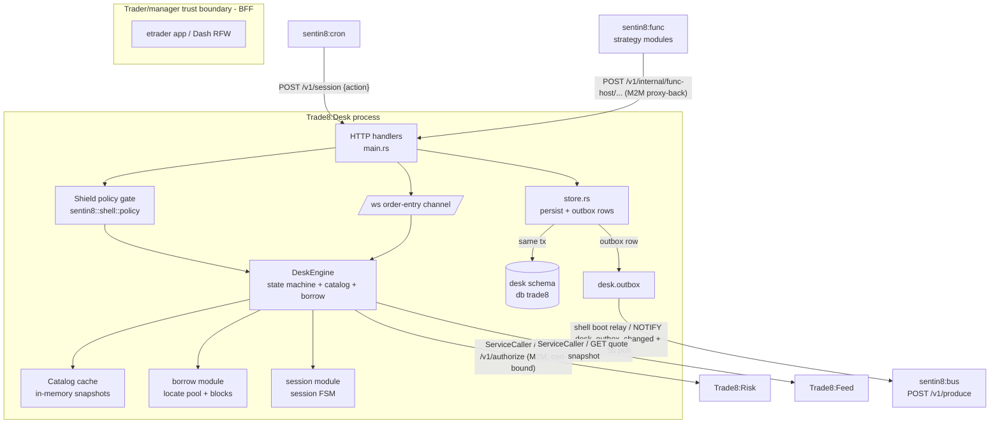

# Trade8:Desk - Order Management Service

> Audience: anyone evaluating or onboarding to the service. For the
> wire-level construction read `DESIGN.md`; for business functionality read
> `BUSINESS.md`. Vertical context: the top-level `DESIGN.md`

> (system map) and `BUSINESS.md` (business view).

## 1. Summary

Trade8:Desk is the order-management core of the trade8 vertical. It owns the
order lifecycle (submit → validate → authorize → accept → route → track →
terminal), the working-order state for the trading session, the reference
catalogs (markets, symbols, destinations, rules), the short-sale locate pool,
and the keystroke audit trail. It is the single writer for order state; every
transition is emitted to Sentin8:Bus outbox-first (`desk.outbox` in the same
DB transaction as the `desk.order_event` append).

The service is a Rust binary on the sentin8 shell (`sentin8::shell::ServiceCore`):
axum HTTP router, in-memory state machine + catalog cache, RLS-scoped
PostgreSQL store (schema `desk` in db `trade8`), an outbox relay owned by the
shell, direct TLS callers to Trade8:Risk (authorize) and Trade8:Feed
(close-only/flatten reference prices), and a `/ws` two-way order-entry channel.

## 2. Motivation

Desk-of-the-broker order management has three hard requirements that generic
platform services do not satisfy:

- **Millisecond-class order acceptance.** A submit must complete structural
  validation, a synchronous pre-trade authorization, the acceptance write, and
  event publication before the trader's next keystroke. This rules out any
  queue-poll architecture on the acceptance path.
- **Event-sourced, auditable order state.** Regulators (and support desks) need
  *who did what to which order, when, and why* - including on-behalf-of actions.
  Desk treats every transition as an append-only journal event, not a mutable row update.
- **Session-time volatility with durable state.** The working-order map is session
  memory (fast in-process reads/writes), while the journal is durable; session
  open/close must park or restore overnight orders atomically.

Before the platform, these lived in scattered desktop-era tooling (order
processor, dispatcher, catalog loaders, locate-pool scripts) with no shared
tenancy, authorization, or event vocabulary. Desk consolidates them into one
service on the Sentin8 identity/tenant/event planes.

## 3. Architecture & High-Level Design

The order-acceptance path is deliberately synchronous end-to-end: validate →
authorize over TLS → single DB transaction (order + event + outbox rows) →
HTTP reply. The bus relay is asynchronous and never blocks acceptance.

## 4. Key Traits and Data Structures

- **`struct DeskState`** - the service-wide state: shell `core` (config, pool,
  policy), `engine` (`DeskEngine`), and `wiring` (`DeskWiring`: Risk/Feed callers,
  feature-flagged by `TRADE8_RISK_URL`/`TRADE8_FEED_URL` presence).
- **`DeskEngine`** (`engine.rs`) - the heart: `submit_pending()`,
  `accept_pending()`, `reject_pending()`, `cancel_with_actor()`, `replace()`,
  `flatten()` over a working-order map, plus the catalog, borrow-pool, and
  session sub-commands. Enforces the `OrderState` legality table from
  `trade8::contracts::enums::OrderState`.
- **`Catalog`** (`catalog.rs`) - markets, symbols (incl. futures), destinations,
  gateways, order classes, tick rules, offices, trader profiles, trading
  calendar, market periods, reject codes: loaded at boot from DB, served from memory.
- **`borrow`** - locate-pool arithmetic: pool totals, per-office blocks,
  ETB/HTB classification, short-exempt marks, decrement-on-accept and
  restore-on-cancel semantics.
- **`session`** - the market session FSM (preopen → open → close_pending →
  closed), driven by Cron proxy-back (`POST /v1/session`) or admin action.
- **`store`** - every multi-row write is one SQL transaction: the domain write
  + the append-only event + `insert_outbox_row(...)` event rows, delivered
  by the shell relay.
- **Contracts** - `trade8::contracts::order.{Order, NewOrderRequest, ...}`,
  `trade8::contracts::events` for the event-type vocabulary
  (`trade8:desk:order:submitted/accepted/rejected/...`), fixed-point money via
  `trade8::fixed`.

## 5. Rationale, Trade-offs, and Alternatives

- **Session-time memory + journal, not DB-only state.** In-process maps give
  O(1) working-set access without pool round-trips on the hot path; the
  append-only journal is the durable truth. Rejected: DB-per-transition reads
  (latency), event-sourcing-only (no fast working reads).
- **Synchronous Risk call, not bus-routed authorization.** Authorization must
  block acceptance - latency (sub-ms in-env) and determinism dominate, and
  a deny must return to the trader in the same request. Fire-and-forget would
  allow an un-authorized order to appear accepted. The point-to-point nature is
  reflected in the `trade8::client::calls` contract constants.
- **Catalog cache from DB, invalidation via bus.** Boot loads the catalog once;
  admin mutations would publish `trade8:desk:catalog:updated` for consumers to
  reload. Rejected: per-request catalog reads (pool churn), compile-time
  catalogs (changes require binary restart).
- **Mimalloc allocator** (master design §11): lower tail latency on the
  order-acceptance and WS hot paths; one-line per binary.
- **Borrow pool in Desk (not Risk):** locate approval is desk workflow (block
  release, ETB/HTB lists, short-exempt) while Risk enforces the check at
  authorization time. Keeps desk bookkeeping separated from the pre-trade gate.

## 6. Internal Implementation & Invariants (Private Design)

**Invariants** (always true, verified in `tests/sql_matrix.rs`):

- Every state transition is an event in `desk.order_event` with `prev_state`,
  `new_state`, actor, and reason - the journal row and state change land in
  the same transaction; illegal transitions cannot be represented.
- `submit_pending` → Risk authorize → accept/reject is atomic per order:
  a persist failure rolls back acceptance (`cancel_with_actor`).
- Idempotency: resubmitting an existing idempotency key returns the existing
  order (`duplicate: true`) - no re-authorization, no duplicate row.
- Short-locate reserve happens only on short-intent accept and is restored on
  cancel/reject - the pool row and `desk.short_pool_office_block` update in
  the same tx.
- All store calls run on a transaction obtained via `conn.begin()` after
  `set_tenant_context` - the RLS context is transaction-local, so data access
  and context share the same tx.
- Blotter reads filter explicitly by `env_id` and order scope; RLS is the backstop.
- The `desk.outbox` and `desk.audit_journal` tables follow the shell-generated
  platform contract; the shell relay delivers outbox rows to the bus.

## 7. Unresolved Questions / Future Designs

- **Catalog hot-reload event coverage** - the `trade8:desk:catalog:updated`
  event type exists in `contracts::events` but no service currently emits it
  on catalog mutations; whether admin edits should republish the catalog to
  every env remains an open design point.
- **Borrow-pool event granularity** - the pool emits the summary
  `trade8:desk:borrow:updated` today; whether downstream consumers need
  per-reservation events (`borrow:reserved/released/adjusted` constants exist)
  is open.
- **WS channel backpressure contract under bursty submits** - bounded-queue
  behavior under sustained F-key bursts over slow client links.
- **Cross-env flatten for office managers** - flatten currently acts on the
  caller's own env scope; org-manager cross-env flatten (via the delegation
  gateway) is a future design.

---

**Architecture & Design:** trade8:desk and its underlying concepts were designed by [Hamid Jahanzad](https://www.linkedin.com/in/hamidjahanzad/).
